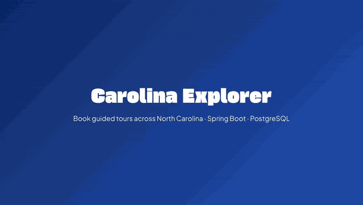

# Carolina Explorer

A tour-booking web app for North Carolina. Tourists search guided tours by city, group size and category, book a date and leave reviews; local tour guides publish tours and manage booking requests, earnings and ratings from a dashboard. Built with Spring Boot, Spring Security, Spring Data JPA, PostgreSQL and FreeMarker as a team project for CSC 340 at UNC Greensboro.



▶️ **[Watch the full demo video](https://sangyetengkhar.com/projects/carolinaExplorer.mp4)** (1 min 54 s, includes sign-up, creating a tour and reviews)

## Features

**For tourists**
- **Discover tours:** browse by city (Asheville, Charlotte, Raleigh, Wilmington), by tour type (food, history, nature, adventure), or through featured tours ranked by rating.
- **Search and filter:** by city, group size, price range and category.
- **Tour details:** photo gallery, itinerary, what's included, duration, group size, age requirement and reviews.
- **Book tours:** pick a date, group size and public or private tour, and add special requests. Bookings stay pending until the guide accepts.
- **Profile:** upcoming, pending, past and rejected trips, with the option to cancel. Reviews can be left after a trip, and they feed into the tour's rating.

**For tour guides**
- **Publish tours** with descriptions, itinerary, pricing, group limits and photos.
- **Dashboard:** accept or reject booking requests, and see upcoming and completed tours, total earnings and average rating.

**Security**
- Passwords are hashed with BCrypt, every form is CSRF-protected, and booking actions check that the signed-in user owns the tour or the booking.

## Project structure

```
mvc-app/                    The web app (Spring Boot MVC with FreeMarker templates)
├── src/main/java/...       Controllers, services, repositories and JPA entities
├── src/main/resources/     Templates, static images and application.properties
├── src/test/java/...       Unit tests
└── Dockerfile              Container build for deployment
backend-api/                An earlier REST-only version of the backend
docs/                       Requirements (SRS), testing plan, UML class diagram and presentation
high-fidelity-prototype/    Figma prototypes for the tourist and guide sides
render.yaml                 Render Blueprint for one-click deployment
```

## Running it locally

You need Java 25 (or Docker) and a PostgreSQL database, either local or a free [Neon](https://neon.tech) database. The database connection comes from environment variables:

```bash
export DATABASE_URL="jdbc:postgresql://localhost:5432/carolina"
export DATABASE_USERNAME="your_db_user"
export DATABASE_PASSWORD="your_db_password"

cd mvc-app
./mvnw spring-boot:run
```

Open http://localhost:8080. The tables are created automatically on the first run. See [`mvc-app/README.md`](mvc-app/README.md) for detailed setup, Docker, deployment to Render, the architecture and all routes. Run the tests with `./mvnw test`.

## Built with

- **Backend:** Java, Spring Boot 4, Spring Security, Spring Data JPA (Hibernate)
- **Frontend:** FreeMarker templates, Bootstrap, CSS
- **Database:** PostgreSQL (Neon)
- **Tooling:** Maven, Docker, JUnit and Mockito, Figma

## Team

- **Sangye Tengkhar**
- **Ayusha Thapa**

Built for CSC 340 at UNC Greensboro, 2026.
